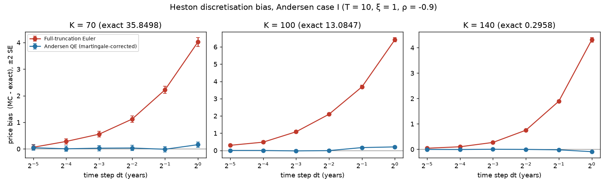
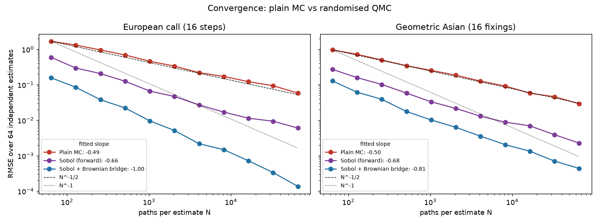
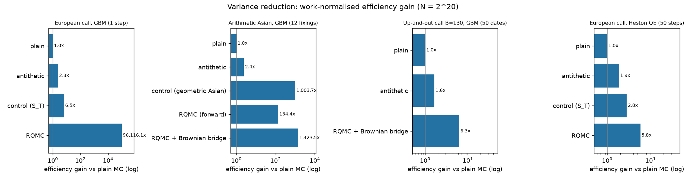
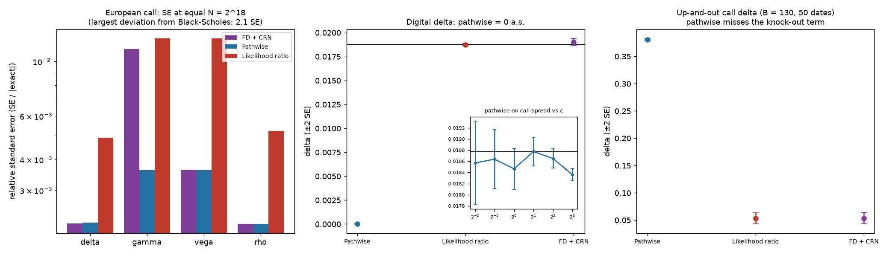
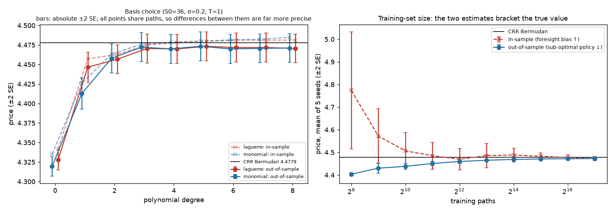
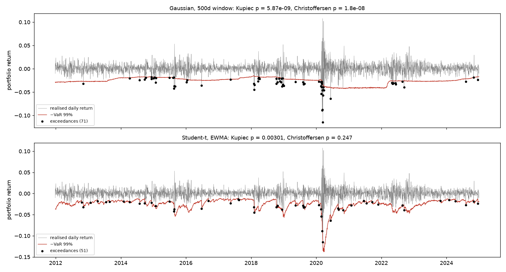
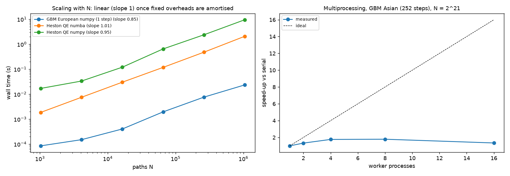

# mc-engine

A Monte Carlo derivatives pricing and risk engine in Python, built around one question:
**how do you know the number is right?** Every estimator is validated against a closed-form
or independent numerical benchmark, its *error bar* is tested as well as its value, and
every number on this page comes from a script in [`benchmarks/`](benchmarks) whose output is
committed in [`docs/results/`](docs/results).

* **Models:** GBM (exact), Heston (full-truncation Euler and Andersen QE), Merton jump-diffusion (exact)
* **Payoffs:** European, digital, arithmetic and geometric Asian, up-and-out barrier, lookbacks, American (Longstaff-Schwartz)
* **Variance reduction:** antithetic, control variates, scrambled Sobol QMC with Brownian bridge
* **Greeks:** finite differences with common random numbers, pathwise, likelihood ratio
* **Risk:** correlated GBM and Student-t copula scenarios, VaR/ES, Kupiec and Christoffersen backtests on 13 years of real data
* **Performance:** parallel numba kernels (5.5x on Heston), multiprocessing with reproducible seed streams
* **Quality:** 262 tests (statistical, property-based with hypothesis, regression), 99% line coverage, ruff, GitHub Actions

The maths is derived in [`docs/maths.md`](docs/maths.md). The notebook
[`notebooks/walkthrough.ipynb`](notebooks/walkthrough.ipynb) re-runs the key results end to end in about 20 seconds.

---

## Install and use

```bash
git clone <this repo> && cd mc-engine
python -m venv .venv && source .venv/bin/activate   # Windows: .venv\Scripts\activate
pip install -e ".[dev,fast]"        # fast = numba (optional); add risk = yfinance to re-download data
pytest                               # ~1 minute
```

```python
from mc_engine import Heston, mc_price
from mc_engine.payoffs import ArithmeticAsian
from mc_engine.analytic import heston_price

model = Heston(S0=100, v0=0.04, kappa=1.5, theta=0.04, xi=0.6, rho=-0.7, r=0.03, backend="numba")
print(mc_price(model, ArithmeticAsian(K=100), maturity=1.0, n_steps=100, n_paths=200_000, rng=42))
# price=4.992595  se=0.012533  95% CI=[4.968031, 5.017160]  N=200,000  (0.472s)
```

```bash
mc-engine price --model heston --payoff asian --S0 100 --K 100 --T 1 --r 0.03 --steps 100 --paths 200000
mc-engine price --model gbm --payoff european --S0 100 --K 100 --T 1 --r 0.05 --sigma 0.2 --qmc
mc-engine price --model gbm --payoff american --put --S0 36 --K 40 --T 1 --r 0.06 --steps 50
mc-engine greeks --S0 100 --K 105 --T 1 --r 0.05 --sigma 0.2 --method all
```

Whenever a reference exists, the CLI prints it next to the estimate, with the gap in standard errors.

## Design

```
cli / notebooks / benchmarks                  presentation
pricer · greeks · american · risk · parallel  estimators
models · payoffs · variance_reduction         building blocks
rng · brownian_bridge · analytic · kernels    primitives and reference solutions
```

* **All randomness flows through one `RandomSource` interface**, which returns blocks of shape
  `(paths, steps, factors)`. Antithetic sampling, common random numbers, Sobol QMC and the
  Brownian bridge are all just different sources, so no model code changes for any of them.
  There is no global RNG state, and parallel streams come from `SeedSequence.spawn`.
* **Payoffs are pure functions of the path matrix** and expose their almost-sure gradient, so
  pathwise Greeks follow from the chain rule for any payoff. The digital and barrier failures
  are not special cases: they are what the derivative of a step function *is*.
* **Exact schemes wherever they exist** (GBM, Merton), so the only error is statistical.
  For Heston, the discretisation bias is measured rather than assumed away.

## How it is validated

| Check | How |
|---|---|
| Unbiasedness | MC vs Black-Scholes, digital and geometric-Asian closed forms, Merton series, Heston CF, within 4 SE (fixed seeds) |
| The error bar itself | Over 500 seeds, the 95% CI covers the BS price a Binomial(500, 0.95)-consistent number of times; same for antithetic, control-variate and RQMC estimators |
| Reference implementations | Heston CF by two independent inversions (Lewis and Gil-Pelaez, agree to 1e-7), BS limit as ξ→0, CRR tree vs BS |
| Convergence rates | Fitted log-log slopes: MC in [−0.6, −0.4]; RQMC + bridge < −0.7 |
| No-arbitrage | hypothesis property tests on random models: put-call parity, monotonicity, barrier ≤ vanilla, geometric ≤ arithmetic Asian, lookback bounds (all pathwise, so exact) |
| Greeks | Each method vs BS Greeks; FD vs the *finite difference* of the closed form (its exact expectation); geometric-Asian Greeks vs closed form |
| Risk statistics | Kupiec and Christoffersen have the right size under the null (~5% rejections) and detect clustering |
| Fast code | numba kernels reproduce the numpy reference to round-off (1e-14), on both QE branches and irregular grids |

When a test failed, the cause was investigated and documented, not tolerance-tuned. Examples are in
the commit history and in test docstrings: a floating-point off-by-one in empirical VaR
(`100 × (1 − 0.95) = 5.000000000000004`), a silently-dropped CRN when a stateful RNG was passed to
finite differences, and catastrophic cancellation in the inverse normal at p = 1 − 10⁻¹⁵.

---

## Results

### 1. Heston: Euler vs QE discretisation bias



Andersen's case I (ξ = 1, ρ = −0.9, T = 10; Feller badly violated), 200k paths per point.
Full-truncation Euler's bias roughly halves with each halving of dt: at K = 100 it is +6.41 at
dt = 1 and still **+0.30 (10 SE) at dt = 1/32**. QE is statistically unbiased from dt = 1/4.
This error does not shrink with more paths. ([csv](docs/results/heston_bias.csv))

### 2. Convergence: Monte Carlo vs randomised QMC



RMSE over 64 independent estimates against exact prices. Fitted slopes:

| | Plain MC | Sobol (forward) | Sobol + Brownian bridge |
|---|---:|---:|---:|
| European call, 16 steps | −0.49 | −0.66 | **−1.00** |
| Geometric Asian, 16 fixings | −0.50 | −0.68 | **−0.81** |

MC hits the CLT rate exactly. The bridge is what turns QMC's potential into a better rate,
by concentrating variance in the first Sobol coordinates.

### 3. Variance reduction



2²⁰ paths per technique. *VR ratio* = variance reduction at equal paths. *Efficiency gain* also
accounts for runtime (SE² × time), i.e. the speed-up in time-to-accuracy.

| Problem | Technique | VR ratio | Efficiency gain |
|---|---|---:|---:|
| Arithmetic Asian (12 fixings) | antithetic | 2.1 | 2.4 |
| | control variate (geometric Asian, ρ = 0.99957) | 1,283 | 1,004 |
| | RQMC, forward construction | 192 | 134 |
| | **RQMC + Brownian bridge** | **3,013** | **1,424** |
| Up-and-out call, 50 dates | antithetic | 1.5 | 1.6 |
| | RQMC + Brownian bridge | 13.4 | 6.3 |
| European call, Heston QE | antithetic | 1.8 | 1.9 |
| | control variate (S_T) | 3.0 | 2.8 |
| | RQMC | 4.4 | 5.8 |

The control-variate gain matches theory, 1/(1−ρ²) ≈ 1,160. The discontinuous barrier
benefits least. Full table: [variance_reduction.md](docs/results/variance_reduction.md).

### 4. Greeks: FD, pathwise, likelihood ratio



European call, S0 = 100, K = 105, 2¹⁸ paths:

| Greek | Black-Scholes | FD + CRN | Pathwise | Likelihood ratio |
|---|---:|---:|---:|---:|
| delta | 0.5172 | 0.5160 ± 1.1e-3 | 0.5161 ± 1.1e-3 | 0.5126 ± 2.5e-3 |
| gamma | 0.0197 | 0.0199 ± 2.2e-4 | 0.0196 ± 7.1e-5 * | 0.0195 ± 2.4e-4 |
| vega | 39.435 | 39.132 ± 0.14 | 39.132 ± 0.14 | 39.00 ± 0.49 |
| rho | 44.223 | 44.168 ± 0.10 | 44.168 ± 0.10 | 43.82 ± 0.23 |

\* A mixed estimator: the LR weight applied to the pathwise delta, since the call's second
derivative is a Dirac delta.

**Where pathwise fails.**
* Digital option: the pathwise delta is **exactly 0**, against a true 0.01878. LR gives 0.01874 ± 5e-5.
* Up-and-out barrier: pathwise gives **0.381**, while LR (0.053) and FD (0.054) agree. Pathwise
  misses the paths a bump knocks out.
* Smoothing the digital into a call spread restores pathwise, with bias O(ε²) and SE ∝ ε^−½ (both tested).

### 5. American options: Longstaff-Schwartz vs CRR tree



Twenty Longstaff-Schwartz-style cases (K = 40, r = 6%, 50 exercise dates per year). LSM is
compared with a CRR tree on the **same Bermudan schedule**, to separate algorithmic error from
the early-exercise-frequency effect. LSM minus tree is **−0.39 SE on average** (sd 0.91, max |z| 2.6),
consistent with a slightly low-biased estimator. Out-of-sample estimates rise towards the tree
value, and in-sample estimates fall towards it. Monomial and Chebyshev bases give identical prices,
because they span the same space. ([table](docs/results/american_table.md))

### 6. VaR and Expected Shortfall: backtest on real data



Equal-weight AAPL / MSFT / JPM / XOM / JNJ, one-day VaR from a rolling 500-day window with no
look-ahead, over 3,273 days (2012–2024). Prices are cached in [`data/`](data), so tests never touch the network.

| Method | 99% exceedances (expect 32.7) | Kupiec p | Christoffersen p |
|---|---:|---:|---:|
| Historical simulation | 41 | 0.16 | 0.0015 |
| Gaussian, static window | 71 | 6e-9 | 2e-8 |
| Student-t, static window | 56 | 2e-4 | 3e-6 |
| Gaussian, EWMA (λ = 0.94) | 66 | 3e-7 | **0.58** |
| Student-t, EWMA | 51 | 0.003 | **0.25** |

EWMA volatility removes exceedance clustering. Fat tails reduce, but do not cure, the 99%
excess. The diagnosis: devolatilised portfolio returns are **negatively skewed (−0.47)**, with a
1% quantile of −2.88 against −2.62 for the fitted symmetric t. At 95%, every method except the
static Gaussian passes Kupiec, but only the EWMA models also pass Christoffersen. On the risk report side, √10 scaling overstates the 10-day 99% VaR under fat
tails by 12% (a sum of t-shocks is closer to normal), while ES/VaR at 99% rises from 1.15
(Gaussian) to 1.33 (t). ([table](docs/results/var_backtest.md), [report](docs/results/var_report.csv))

### 7. Performance



AMD Zen 4 laptop (8 cores / 16 threads), Windows 11, Python 3.15, numba 0.68:

| Heston, 100 steps, 2¹⁸ paths | Paths/sec | Speed-up |
|---|---:|---:|
| QE, numpy | 100k | 1.0x |
| QE, numba (16 threads) | **550k** | **5.5x** |
| Euler, numpy | 281k | 1.0x |
| Euler, numba (16 threads) | 561k | 2.0x |

Run time scales linearly in N (fitted slope 1.0). The remaining serial share is random-number
generation (45% of numba run time), kept serial on purpose so both backends use identical
draws. Multiprocessing for the GBM Asian peaks at **1.8x**: worker spawn on Windows costs 2.3 s, and
the workers contend for memory bandwidth. ([details](docs/results/performance.md))

---

## What I learned

* **Test the error bar, not just the estimate.** A coverage test over hundreds of seeds catches
  wrong standard errors (e.g. treating antithetic pairs as independent) that a single
  "within 3 SE" check never would. It also caught me reading too much into one unlucky seed.
* **Bias and noise are different errors.** Euler's Heston bias is still 10 SE at dt = 1/32, and
  more paths make it *more* visible, not less.
* **Structure beats brute force.** A control variate with a known mean and a Brownian bridge
  each beat plain MC by about 1,000x in time-to-accuracy. Generic tricks like antithetics give about 2x.
* **The conditions in a theorem matter.** Pathwise Greeks need Lipschitz payoffs, and digitals
  and barriers show exactly what happens when that fails.
* **Profile, then apply Amdahl's law.** The first numba kernel was fast and almost useless (2.3x),
  because 92% of the time was outside it.
* **Real data disagrees politely.** Volatility clustering matters more than tail shape, and the
  remaining 99% failure has a specific, diagnosable cause (skew). I report it rather than tune it away.

## Limitations

* **Discrete monitoring only.** Barriers and lookbacks are observed on the simulation grid. The
  Broadie-Glasserman-Kou correction is used for validation, not pricing.
* **No calibration.** Heston and Merton parameters are taken from the literature or chosen
  for illustration, not fitted to an implied volatility surface.
* **LSM gives a lower bound only.** There is no dual upper bound (Andersen-Broadie), and the
  regression state is spot only, which is sub-optimal for Heston, where variance matters too.
* **The VaR model fails at 99%.** A symmetric t cannot fit the skew. Filtered historical
  simulation or a skewed-t would be the next step, deliberately not added after seeing the data.
  The VaR is for a static portfolio, with no liquidity effects, and options in the risk report are
  revalued at constant volatility.
* **Pathwise and LR Greeks are implemented for GBM only.** Heston Greeks are available only
  through finite differences.
* **The performance numbers come from one Windows laptop.** Multiprocessing would look better on
  Linux, where `fork` avoids re-importing in every worker.
* **CPU only.** There is no GPU backend.

## Reproduce every number

```bash
python benchmarks/heston_bias.py        # ~1 min
python benchmarks/convergence.py
python benchmarks/variance_reduction.py
python benchmarks/greeks.py
python benchmarks/american.py           # ~3 min
python benchmarks/var_backtest.py       # ~30 s, uses cached prices
python benchmarks/performance.py        # machine-dependent
```

## Layout

```
src/mc_engine/   rng, models/, payoffs, pricer, variance_reduction, brownian_bridge,
                 greeks, american, analytic/ (BS, Heston CF, Merton, CRR), risk/,
                 parallel, _numba_kernels, cli
tests/           one file per module + validation, properties, real-data backtest
benchmarks/      scripts producing docs/results/*
docs/            maths.md, results/
notebooks/       walkthrough.ipynb (executed)
data/            cached daily prices (2010-2024)
```

## References

* Glasserman, *Monte Carlo Methods in Financial Engineering* (2004)
* Andersen, "Simple and efficient simulation of the Heston stochastic volatility model" (2008)
* Lord, Koekkoek and van Dijk, "A comparison of biased simulation schemes for stochastic volatility models" (2010)
* Albrecher, Mayer, Schoutens and Tistaert, "The little Heston trap" (2007)
* Longstaff and Schwartz, "Valuing American options by simulation: a simple least-squares approach" (2001)
* Broadie, Glasserman and Kou, "A continuity correction for discrete barrier options" (1997)
* Kupiec (1995); Christoffersen (1998) on VaR backtesting
